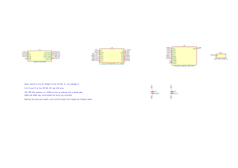
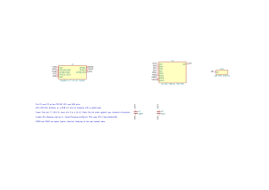

# Proflame2-Remote

Controls a SIT Proflame 2 gas fireplace by sending the same 315 MHz frames as its
GTMF6L remote (FCC ID T99058404300), from an ESP32-S3, an Arduino Uno or a Raspberry Pi
with a CC1101 radio. The Pi is the planned final build, connected to Home Assistant over MQTT.

**Status: nothing has been transmitted yet.** The frames are checked against captures
from the real remote and the rtl_433 decoder, the sketches compile, and the Pi service
passes its tests with a fake radio. No board has been built, so we don't yet know that the fireplace accepts them. Next steps are in
[docs/notes.md](docs/notes.md).

**This controls a gas appliance.** Keep the original remote within reach, keep a working
CO detector nearby, and stay next to the fireplace for every test.

## What's here

| Path | What it is |
| --- | --- |
| `arduino_serial_input/` | Set levels from the serial monitor. Builds for Uno R3 and ESP32-S3. |
| `esp32s3_mqtt_rest/` | REST, MQTT and serial, ESP32-S3 only. |
| `libraries/Proflame2/` | Frame encoder, state and auto-off timer, CC1101 driver, serial commands. |
| `pi/` | Pi service: MQTT, Home Assistant discovery, auto-off timer. Runs in Docker. |
| `hardware/` | KiCad schematics, with PDF and SVG exports. |
| `tests/` | Host tests, plus a round trip through the real rtl_433 decoder. |
| [docs/notes.md](docs/notes.md) | What we learned, the capture, and the plan from here. |
| [docs/protocol.md](docs/protocol.md) | On-air format and checksum. |
| [docs/wiring.md](docs/wiring.md) | Pin tables and wiring diagrams. |
| [docs/interfaces.md](docs/interfaces.md) | Serial commands, REST API and MQTT topics. |
| [docs/pi_service.md](docs/pi_service.md) | The Pi service: settings, failure behaviour, testing. |
| [docs/home_assistant.md](docs/home_assistant.md) | Connecting the Pi service to Home Assistant. |

## Schematics

- ESP32-S3 (serial, MQTT, REST): [PDF](hardware/esp32s3_cc1101.pdf), [KiCad](hardware/esp32s3_cc1101.kicad_sch)
- Uno R3 (serial only): [PDF](hardware/uno_cc1101.pdf), [KiCad](hardware/uno_cc1101.kicad_sch)
- Raspberry Pi GPIO (MQTT, Home Assistant): [PDF](hardware/rpi_cc1101.pdf), [KiCad](hardware/rpi_cc1101.kicad_sch)






## Bill of materials

You only need one build. The ESP32-S3 is the easiest to test with, because it has a serial
console for setting levels by hand. The Pi is the final build and needs no level shifter
either, but it has no serial console: you drive it over MQTT.

### Both builds

| Have | Qty | Part | Notes |
| --- | --- | --- | --- |
| [ ] | 1 | CC1101 module, **315 MHz** version | Most listings are 433 MHz, whose antenna match is wrong for 315 MHz. Check the listing. It must expose CSN, SCK, MOSI, MISO, VCC and GND. |
| [ ] | 1 | 315 MHz antenna | Usually comes with the module. Otherwise, 23.8 cm of wire on the antenna pad. |
| [ ] | 1 | 100 nF ceramic capacitor | Across VCC and GND at the module. |
| [ ] | 1 | 10 uF capacitor | Same place. Mind the polarity if it's electrolytic. |
| [ ] | 1 | Breadboard and jumper wires | Keep the SPI wires short. |

### ESP32-S3 build

| Have | Qty | Part | Notes |
| --- | --- | --- | --- |
| [ ] | 1 | Seeed XIAO ESP32-S3, with its Wi-Fi antenna | An ESP32-S3-DevKitC-1 also works on the same GPIO numbers. |
| [ ] | 1 | USB-C data cable and 5 V supply | |

### Uno build

| Have | Qty | Part | Notes |
| --- | --- | --- | --- |
| [ ] | 1 | Arduino Uno R3 | The R4 isn't supported by the sketch. |
| [ ] | 1 | 4-channel BSS138 level shifter | **Required**: the CC1101 is not 5 V tolerant. See [docs/wiring.md](docs/wiring.md) for a resistor alternative. |
| [ ] | 1 | USB-B cable | |

### Raspberry Pi build

| Have | Qty | Part | Notes |
| --- | --- | --- | --- |
| [ ] | 1 | Any Raspberry Pi with a 40-pin header | A Zero 2 W is plenty. A Zero needs its header soldered on. |
| [ ] | 1 | microSD card and power supply | |

### For testing

| Have | Qty | Part | Notes |
| --- | --- | --- | --- |
| [x] | 1 | RTL-SDR with antenna, and `rtl_433` | To check our frames on the air before the fireplace hears them. |

## Build

```bash
arduino-cli core install arduino:avr
arduino-cli core install esp32:esp32 \
  --additional-urls https://espressif.github.io/arduino-esp32/package_esp32_index.json
arduino-cli lib install ArduinoJson "Async TCP"
# espMqttClient isn't in the Library Manager. Its name there matches a different library.
arduino-cli config set library.enable_unsafe_install true
arduino-cli lib install --git-url https://github.com/bertmelis/espMqttClient.git#v1.7.3

# Serial sketch on a Uno (swap the port for yours)
arduino-cli compile --libraries libraries --fqbn arduino:avr:uno arduino_serial_input
arduino-cli upload -p /dev/ttyACM0 --fqbn arduino:avr:uno arduino_serial_input

# Serial sketch on a XIAO
arduino-cli compile --libraries libraries --fqbn esp32:esp32:XIAO_ESP32S3 arduino_serial_input
arduino-cli upload -p /dev/ttyACM0 --fqbn esp32:esp32:XIAO_ESP32S3 arduino_serial_input

# MQTT and REST: fill in secrets.h first (git-ignored)
cp esp32s3_mqtt_rest/secrets.example.h esp32s3_mqtt_rest/secrets.h
arduino-cli compile --libraries libraries --fqbn esp32:esp32:XIAO_ESP32S3 esp32s3_mqtt_rest
arduino-cli upload -p /dev/ttyACM0 --fqbn esp32:esp32:XIAO_ESP32S3 esp32s3_mqtt_rest

arduino-cli monitor -p /dev/ttyACM0 -c baudrate=115200
```

In the Arduino IDE, copy `libraries/Proflame2` into your sketchbook's `libraries` folder.
For MQTT, add the [espMqttClient v1.7.3](https://github.com/bertmelis/espMqttClient/releases/tag/v1.7.3)
zip with Sketch > Include Library > Add .ZIP Library, and install "Async TCP" by ESP32Async
from the Library Manager.

## Tests

```bash
make test                          # host tests for the encoder and controller
make roundtrip RTL_433=/path/to/rtl_433   # real decoder reads back our frames
make compile                       # all sketch and board combinations
make pi-test                       # Pi service; see docs/pi_service.md
make schematics                    # regenerate KiCad files, run ERC, export (needs kicad-cli 9)
```

## This repo holds the remote's identity

`remote_identity.h` contains this remote's serial and checksum constants. Anyone with
them and a radio in range could control the fireplace, so keep the repo private or move
them out first. Wi-Fi, MQTT and API credentials stay in the git-ignored `secrets.h`.

## Credit

The protocol comes from the public work in [rtl_433](https://github.com/merbanan/rtl_433)
(`proflame2.c`), [johnellinwood/smartfire](https://github.com/johnellinwood/smartfire) and
the two proflame2-esp projects ([dangerouslaser](https://github.com/dangerouslaser/proflame2-esp),
[j2deen](https://github.com/j2deen/proflame2-esp)). The code here is written from that
documentation. rtl_433 is only used as a test tool.
